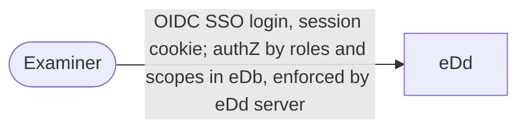
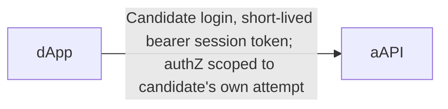
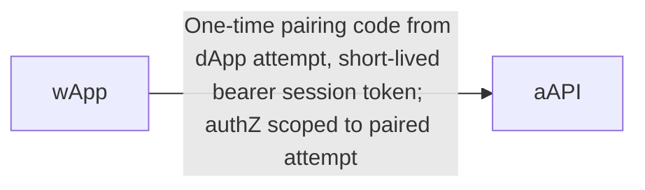
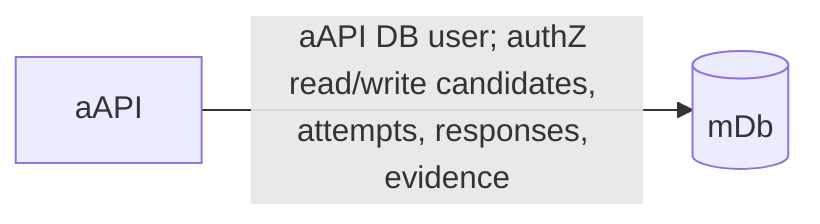
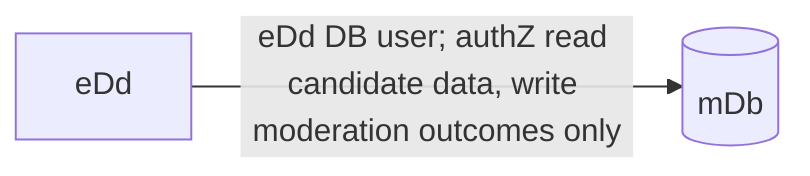
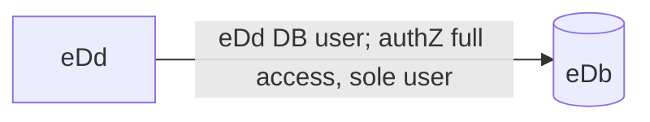

# Auth

All service-to-service traffic stays on the private `platform` network. Each database grants per-service users with least privilege.

## Examiner → eDd

## dApp → aAPI

## wApp → aAPI

## aAPI → mDb

## eDd → mDb

## eDd → eDb

